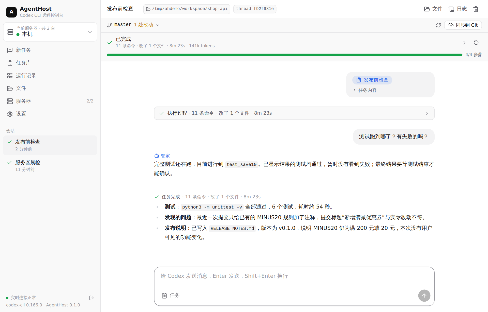
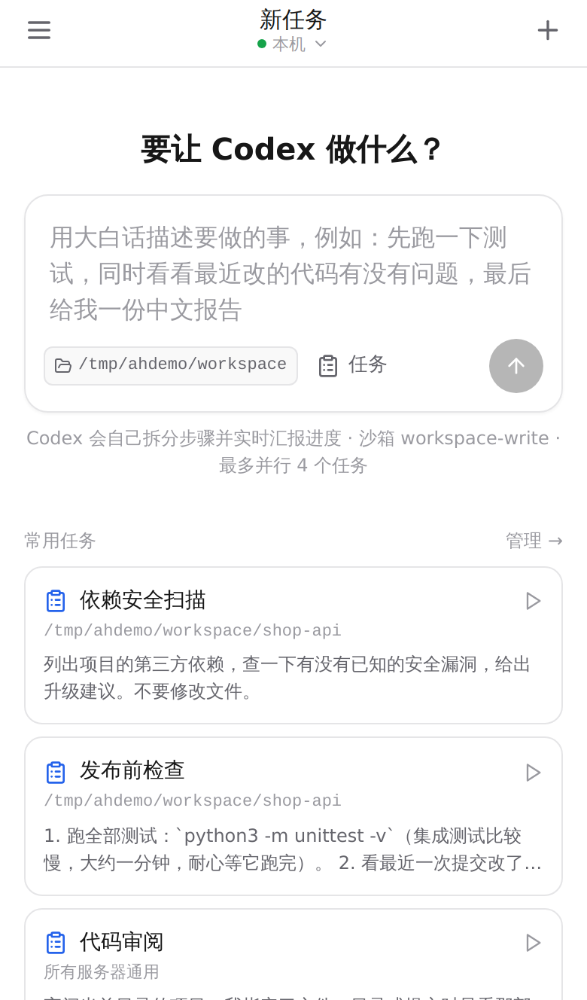
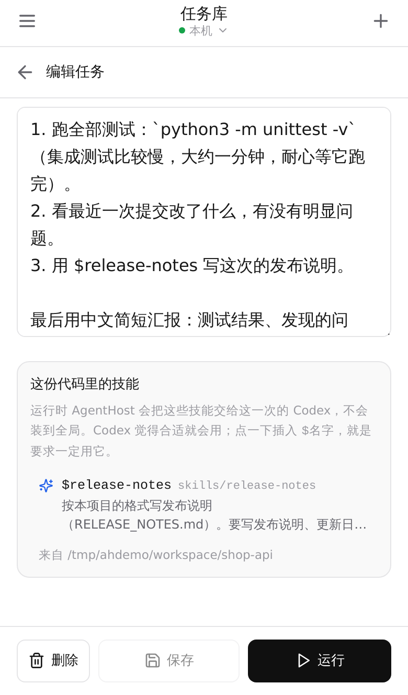
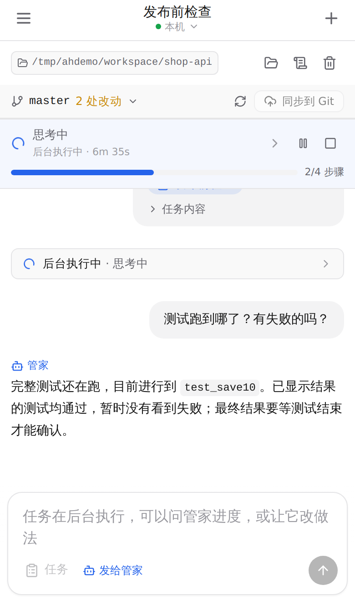
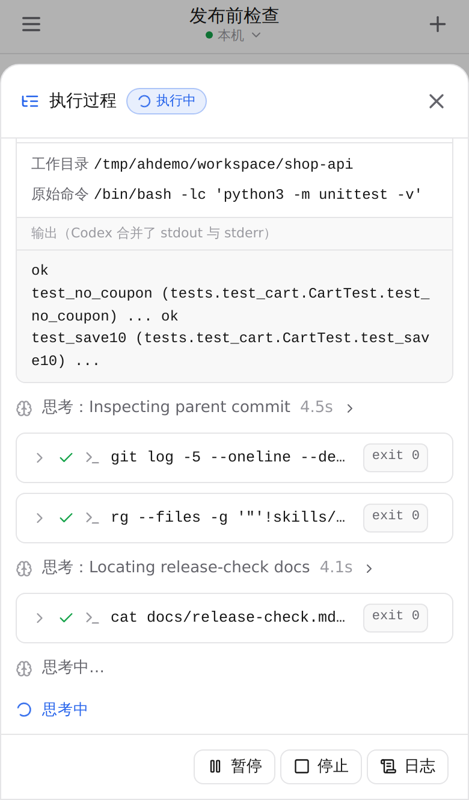
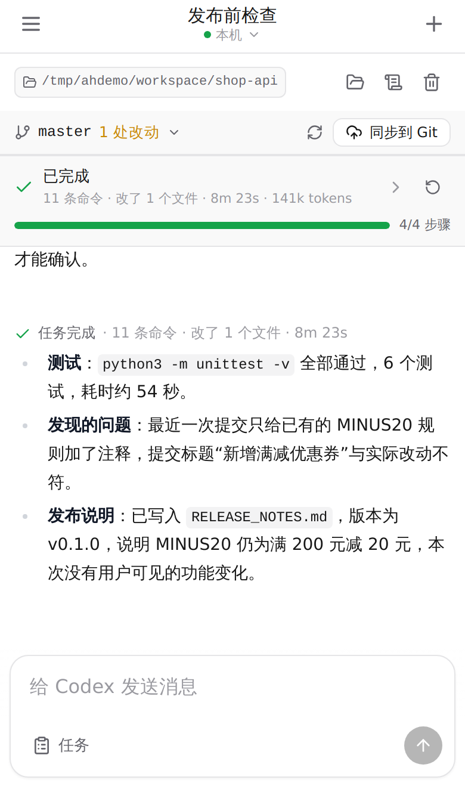
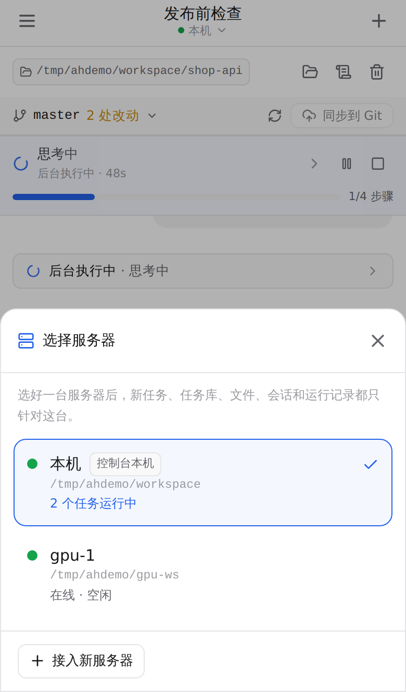

# AgentHost

在手机或电脑浏览器里远程指挥 Codex CLI。用大白话描述要做的事，或者运行存好的任务、代码仓库里的某个 `.md`，Codex 自己拆步骤去做，并实时汇报进度。任务在后台执行时可以继续聊天：问“管家”跑到哪了，或者让它转告 Codex 改做法。代码里自带的技能（`SKILL.md`）会在运行时交给这一次的 Codex，不会装到全局。一个 Web 控制台可以管理多台跑任务的服务器，服务器在内网也可以。

<p align="center">
  
</p>

## 效果

下面的截图来自一次真实运行：在示例仓库 `shop-api` 上跑任务库里的“发布前检查”（跑一分钟的测试、审最近的提交、用仓库自带的 `release-notes` 技能写发布说明），测试进行到一半时问管家进度。

<table>
  <tr>
    <td align="center" width="33%"><br><b>首页</b><br><sub>描述要做的事，或点一下常用任务</sub></td>
    <td align="center" width="33%"><br><b>任务库</b><br><sub>一段大白话 + 在哪个目录运行；下面列出这份代码里的技能</sub></td>
    <td align="center" width="33%"><br><b>任务在后台跑，问管家</b><br><sub>“测试跑到哪了？”管家看了实时输出后回答，干活的 Codex 不受打扰</sub></td>
  </tr>
  <tr>
    <td align="center"><br><b>执行过程</b><br><sub>点顶部任务条展开：命令、输出、退出码、计划、文件改动</sub></td>
    <td align="center"><br><b>任务完成</b><br><sub>结果接在对话后面；这次还发现提交标题和实际改动不符</sub></td>
    <td align="center"><br><b>切换服务器</b><br><sub>选一台，所有页面就只针对这台</sub></td>
  </tr>
</table>

- 后端：Go，单个二进制，内嵌前端
- 前端：React + [assistant-ui](https://www.assistant-ui.com/)，按手机优先设计，可“添加到主屏幕”
- 与 Codex 的连接：`codex app-server`（JSON-RPC），实时拿到回复、思考摘要、命令的工作目录/输出/退出码、文件 diff、计划，能中断，也能往正在进行的回合里插话（`turn/steer`）

## 快速开始

```bash
./start.sh
```

脚本会自动安装缺少的依赖（Go、Node.js 装到 `./.tools`，Codex CLI 用 npm 全局安装），构建，然后启动。日志里会打印登录地址：

```
  AgentHost is running.
  Open:  http://localhost:8080/?token=xxxxxxxx
```

打开后先到 **设置** 填 Codex 的接口地址和 API Key（或者让服务器沿用自己 `~/.codex` 里的配置），点“保存并测试 Codex”。要拉代码、推代码，再在设置里生成 SSH 密钥（把公钥加到 GitHub）或填 HTTPS 访问令牌。

常用参数：`./start.sh --install-only`（只安装和构建）、`./start.sh --rebuild`（强制重新构建）。

### 多台服务器 / 内网穿透

Web 控制台部署在一台能被手机访问的机器上，真正跑任务的机器（可以在内网、NAT 后面、不开任何端口）运行：

```bash
./start.sh node --hub https://控制台地址 --token <节点令牌> --name gpu-1 --workspace /data/projects
```

节点会**主动连**到控制台（WebSocket，断线自动重连），所以只要它能访问控制台就行，不需要公网 IP 或端口映射。节点令牌和完整命令在控制台的 **服务器** 页面里可以直接复制。

- 侧边栏顶部（手机上是顶栏标题下方）切换“当前服务器”。切换后，新任务、任务库、文件、会话列表和运行记录都只针对这台服务器；每个会话属于一台服务器，在会话顶部可以换目录
- 控制台本机默认也能跑任务；只想当控制台用时设置 `AGENTHOST_LOCAL_NODE=off`
- 设置里的 Codex 密钥、Git 凭据会在启动每个任务时下发到对应服务器，不需要登录到那台机器上配置
- 节点断线时，它上面正在跑的任务会被标记失败并结束对应进程；重新连上后可以继续用

如果控制台本身也在内网，用 frp / Cloudflare Tunnel / Tailscale 等把 8080 端口暴露出来即可（SSE 和 WebSocket 都走同一个端口；反向代理请关闭响应缓冲）。

### 容器部署

```bash
docker compose up -d --build      # 控制台；挂载 ./data ./workspace
docker compose logs agenthost     # 查看登录地址和令牌
```

节点用同一个镜像运行 `./start.sh node`（服务器页面里有现成的 docker 命令）。

## 使用

- **当前服务器**：侧边栏顶部（手机上点顶栏标题）选一台服务器，之后新任务、任务库、文件、会话和运行记录都只针对这台
- **新任务**：直接用大白话描述，比如“先跑一下测试，同时看看最近改的代码有没有问题，最后给我一份中文报告”。多步骤的事 Codex 会先列出步骤，再逐步标记完成，顶部任务条实时显示“步骤 2/4：…”和进度
- **任务库**：把常做的事写成一段大白话（要做什么、注意什么、交付什么），可以指定在哪个目录运行；任务属于创建时的服务器，自带的示例在每台服务器上都能用。之后在首页“常用任务”或输入框旁的“任务”里点一下就能跑，还可以补一句说明。自带三个示例：代码审阅、项目体检、服务器晨检。任务存成 `data/tasks/<名字>.md`，开头可选 `名称` / `服务器` / `目录`（也认 `title` / `server` / `cwd`）
- **代码里的任务**：在“文件”里打开仓库中的任意 `.md`，点“作为任务运行”，就在那个文件所在的目录、那台服务器上新开会话，让 Codex 按文件内容做
- **技能**：技能是代码里自带的 `SKILL.md`（每个技能一个文件夹）。每次启动 Codex 时，AgentHost 在会话目录所在的整个仓库里找技能（跳过 `node_modules`、`vendor`、`dist`、`build`、`.venv` 等依赖和构建目录），通过 `skills/extraRoots/set` 只交给这一个 Codex 进程，不写 `~/.codex/skills`，也不改 `config.toml`。Codex 自己会读的 `.agents/skills`、`.codex/skills` 不重复交。时间线里会显示“本任务注入了 N 个技能”。Codex 觉得合适就会用；任务里写 `$技能名` 就是要求一定用它（任务编辑页列出了目录里的技能，点一下即可插入）
- **会话**：一个会话就是一条对话。顶部任务条显示任务的状态、正在做什么、进度，以及暂停、继续、停止、重新运行；点它展开完整的执行过程（命令卡片含工作目录、实时输出、退出码；文件改动有 diff）。对话里只留你说的话、回复和结果，执行过程收成一行。任务结束后再发消息，会接着同一个 Codex 上下文继续做
- **多个 Codex 并行**：输入框下方（以及任务库、运行任务弹窗、“作为任务运行”里）的“1 个 Codex”可以改成 2–8 个。Codex 会把任务拆成互不冲突的几部分，用 Codex 自带的子 agent 同时去做，自己负责分派、检查和汇总；执行过程里每个子 Codex 一张卡片，显示它正在做什么，点开能看它的命令和输出。AgentHost 用 `agents.max_concurrent_threads_per_session` 限制同时干活的子 Codex 数（主 Codex 不算在内），只对这个任务生效。任务库里的任务可以存默认并行数（开头写 `并行: 3`）；会话里接着发的消息沿用上一个任务的设置。token 消耗大约随数量成倍增加
- **管家**：任务在后台执行时，输入框里的消息发给管家。它是另起的一个只读 Codex，每次都能看到任务的实时状态（执行步骤、最近的命令和输出），负责回答“跑到哪了”“为什么报错”；要改做法（比如“第三步不用做了”），它会转告干活的 Codex，对方当场看到并调整；也可以让它暂停或停止任务。问问题不会打断正在干活的 Codex
- **Git**：会话目录是 Git 仓库时，顶部显示分支和改动数；点“同步到 Git”，Codex 会检查改动、写提交信息、`pull --rebase` 后推送（不会强推，冲突会停下来问你）
- **文件**：只读浏览任意服务器上的目录和文件，看任务产出；文本带行号，图片直接显示，可下载
- **运行记录**：当前服务器上所有任务的状态、进度和控制按钮，按状态筛选，每页 30 条，往下点“加载更多”。已结束的记录可以单条删除（对话里的这次任务和日志一起删除），也可以点“清理”批量删除 7 天前、30 天前或全部已结束的记录；还可以设置自动清理（保留 7 / 30 / 90 天）。一个会话的记录删光时，会话也一起删除
- **运行日志**：每个任务的完整日志（调度、命令、Codex JSON-RPC、Codex stderr），可筛选、搜索、下载

## 配置

环境变量（也可以写在项目根目录的 `.env`）：

| 变量 | 默认值 | 说明 |
| --- | --- | --- |
| `AGENTHOST_ADDR` | `:8080` | 监听地址 |
| `AGENTHOST_TOKEN` | 自动生成，存于 `data/token` | 登录令牌 |
| `AGENTHOST_AUTH=none` | — | 关闭登录（仅限可信网络） |
| `AGENTHOST_DATA` | `./data` | 会话、运行记录、日志、设置、任务库（`data/tasks`） |
| `AGENTHOST_WORKSPACE` | `./workspace` | 本机任务的默认工作目录 |
| `AGENTHOST_LOCAL_NODE=off` | — | 控制台本机不跑任务 |
| `AGENTHOST_NODE_TOKEN` | 自动生成，存于 `data/node-token` | 服务器接入用的令牌 |
| `AGENTHOST_SANDBOX` | `workspace-write` | Codex 沙箱 |
| `AGENTHOST_APPROVAL_POLICY` | `never` | Codex 审批策略 |
| `AGENTHOST_MAX_RUNS` | `4` | 同时执行的任务上限 |
| `AGENTHOST_CODEX_CONFIG` | — | 额外的 `codex -c` 覆盖，`;` 分隔 |
| `CODEX_BIN` | `codex` | Codex 可执行文件 |

节点（`./start.sh node`）用 `AGENTHOST_HUB`、`AGENTHOST_NODE_TOKEN`、`AGENTHOST_NODE_NAME`、`AGENTHOST_WORKSPACE`、`AGENTHOST_DATA`（默认 `./node-data`），也可以用对应的命令行参数。

Codex 接口、API Key、模型、是否允许联网、Git 凭据都在网页的 **设置** 里配置，保存在 `data/settings.json`（权限 600）。

## 安全

- 能登录 AgentHost 的人就能在所有已接入的服务器上执行命令。保管好登录令牌和节点令牌，公网访问请放在 HTTPS 之后
- 设置里的密钥不会回传给浏览器；Codex API Key 以环境变量的形式传给 Codex，Git 令牌通过 git 的 credential helper 提供，SSH 私钥写在各服务器数据目录的 `private/` 下（权限 600）
- Codex 默认在 `workspace-write` 沙箱里执行命令：不能写工作目录以外的地方，不能改 `.git`，默认不能联网（可在设置里打开）；“同步到 Git”任务会单独放开联网和该仓库的 `.git`

## API

所有接口需要登录 Cookie 或 `Authorization: Bearer <token>`。

| 方法 | 路径 | 说明 |
| --- | --- | --- |
| `POST` | `/api/tasks` | 开始运行：`{"text"}`、`{"task": 任务库里的名字}` 或 `{"taskFile": 服务器上的 .md}`（`text` 作为补充说明），可选 `nodeId`、`cwd`、`sessionId`、`parallel`（同时用几个 Codex） |
| `GET` | `/api/runs`、`/api/runs/{id}`、`/api/runs/{id}/logs` | 运行记录（`?node=&status=&tasks=1&limit=&before=` 分页）、详情、日志 |
| `GET` | `/api/runs/stats?node=` | 各状态的数量 |
| `DELETE` | `/api/runs/{id}` | 删除一条已结束的记录 |
| `POST` | `/api/runs/cleanup` | 批量删除：`{"node", "olderThanDays", "dryRun"}`（`olderThanDays: 0` 表示全部已结束的） |
| `POST` | `/api/runs/{id}/pause`·`resume`·`stop`·`retry` | 控制 |
| `GET/POST/PATCH` | `/api/sessions…` | 会话；`/sessions/{id}/git`、`/sessions/{id}/git/sync` |
| `POST` | `/api/sessions/{id}/chat` | 发消息：任务执行中发给管家，否则接着任务继续；`{"text", "task"?}` |
| `GET/POST/PUT/DELETE` | `/api/tasklib`、`/api/tasklib/{name}` | 任务库 |
| `GET` | `/api/skills?node=&path=` | 某个目录（所在仓库）里的技能 |
| `GET` | `/api/nodes`、`/api/files`、`/api/files/content` | 服务器、文件浏览 |
| `GET/PUT` | `/api/settings` | 设置（密钥只写不读） |
| `GET` | `/api/events` | Server-Sent Events 实时推送 |

## 开发

```bash
go test ./...                         # 后端测试（用模拟的 codex app-server，含多服务器）
cd web && npm install && npm run dev  # 前端开发服务器，/api 代理到 :8080
```

目录：`cmd/agenthost` 入口与 `node` 子命令 · `internal/node` 服务器抽象、本机执行、WebSocket 隧道 · `internal/codex` app-server 客户端 · `internal/engine` 调度、任务库、技能注入、设置、文件、Git · `internal/workflow` 旧版 workflow 解析（兼容老任务） · `internal/server` HTTP · `web/` 前端 · `tasks/` 示例任务。
